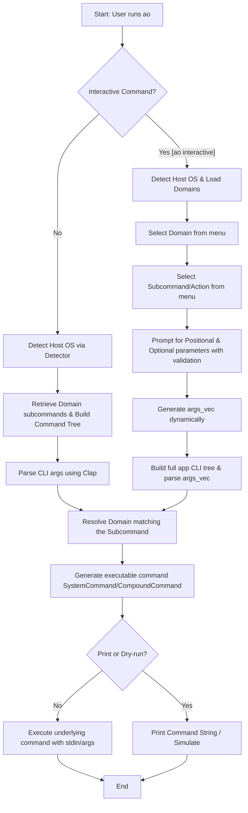
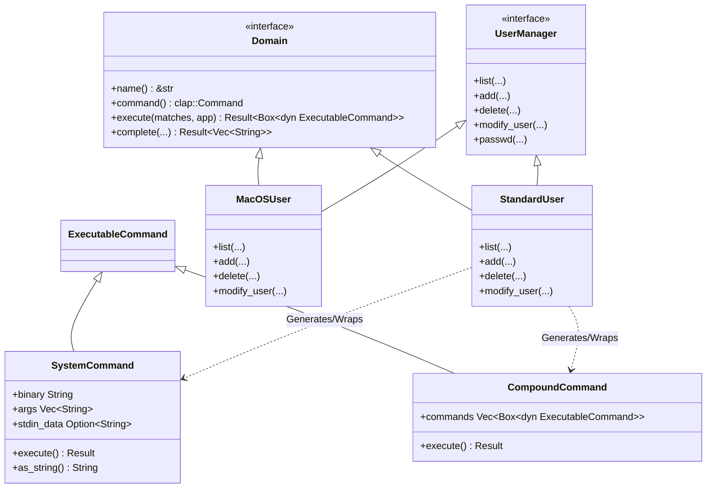
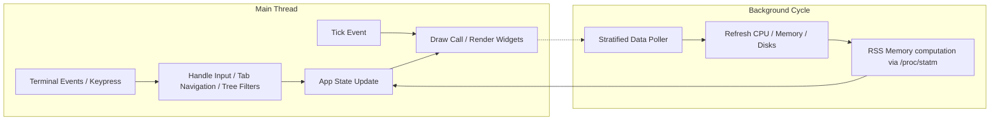

# Project Architecture & Structure

This document outlines the architecture and structure of `ao`, a unified administration tool for Linux systems.

## 1. High-Level Command Execution Flow

`ao` supports two primary execution flows: **Direct Execution** (running commands directly from the shell) and **Interactive Selection** (guided prompting using `dialoguer`).

---

## 2. Abstraction Model

`ao` separates system operations into logical domains (like `user`, `network`, `package`, `service`) using Rust traits. This separates platform-agnostic CLI definition and parsing from platform-specific execution.

---

## 3. Dashboard Architecture

The interactive system monitor (`ao dashboard`) runs a decoupled event loop built using the `ratatui` crate. It isolates rendering logic from background system polling to ensure interface responsiveness.

